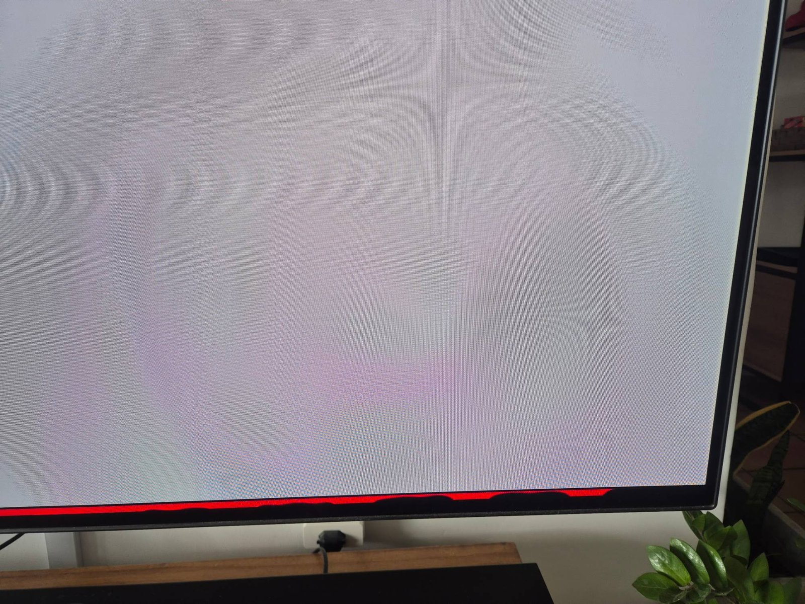
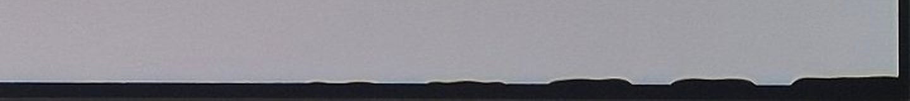
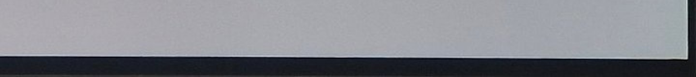
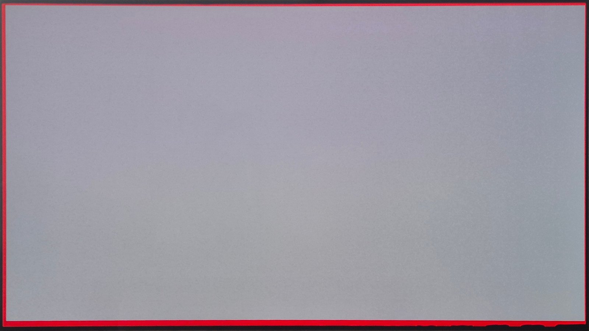

# webos-screenmask

Black masks on the edges of a rooted LG webOS TV screen. They stay on top of
every app, input and menu, and they never take focus.

The use case is an OLED panel with a damaged edge: delamination, burn-in or a
dead strip. You can mask any edge, a segment of an edge, or several areas at
once, each with its own size.



*A 20 px mask in red, for placement, over a delaminated bottom edge. The black
waves inside the red are the damage. Switched to black, the edge becomes a
straight border. See the [tutorial](docs/tutorial.md).*

### Before and after

The bottom-right corner of the same screen, on a white page:





*Top: no mask, the delamination eats into the picture. Bottom: a 20 px black
mask on the bottom edge.*

### Any edge, any size



*Four masks in red: 40 px on the bottom, 24 px on the other three edges.*

- Several masks: `top`, `bottom`, `left`, `right`, full edge or a segment
- Sizes in panel pixels
- Red preview to place a mask over the damage before it turns black
- No compositor restart, no flicker, no change to the foreground app
- Survives reboots, app switches and input switches
- Runs only on the TV: `sh`, `awk`, `luna-send`. No server, no network.

> Tested only on an LG C1 (webOS 6.4.0, firmware 03.41.05). It needs root. You
> use it at your own risk. Read [Compatibility](#compatibility) first.

## Requirements

- Root access through [RootMyTV](https://rootmy.tv/) or the
  [Homebrew Channel](https://github.com/webosbrew/webos-homebrew-channel) root,
  with the webosbrew `init.d` hooks (`/var/lib/webosbrew/init.d`)
- **SSH Server turned on** in the Homebrew Channel settings. It is off by
  default. The [tutorial](docs/tutorial.md#before-you-start-root-and-ssh) walks
  through it.

## Install

### Windows

1. Download the repository (**Code → Download ZIP**) and extract it.
2. Double-click `screenmask-windows.cmd`.
3. Enter the TV IP address, then choose **1 Install or update**.

The same menu adds, changes, previews and removes masks. It uses only what
ships with Windows 10 (1809 or later) and 11: PowerShell, `ssh.exe` and
`tar.exe`.

The TV asks for the root password, `alpine` by default on the Homebrew Channel.
An install asks once per part of the upload, usually twice. Choose **K** in the
menu to install an SSH key and stop the prompts.

### Linux and macOS

From a computer, copy the repository to the TV and run the installer there:

```sh
tar czf - webos-screenmask | ssh root@<tv-ip> 'tar xzf - -C /tmp'
ssh root@<tv-ip> sh /tmp/webos-screenmask/install.sh
```

The installer checks the TV, copies the files to `/var/lib/screenmask`, links
the boot hook and attaches the masks. It does not restart anything. An upgrade
keeps your masks.

## Use

Run `screenmask` on the TV, over SSH:

```sh
screenmask add bottom 20          # m1: 20 px on the whole bottom edge
screenmask preview                # all masks red for 15 s: check the position
screenmask on                     # show the masks
screenmask add left 8 300 600     # m2: 8 px on the left edge, from y=300, 600 px long
screenmask set m1 size=24 start=100 length=800
screenmask remove m2
screenmask status
```

All sizes are panel pixels. `start` and `length` run along the edge: from the
left for `top` and `bottom`, from the top for `left` and `right`. A `length` of
`0` covers to the end of the edge.

The TV UI runs at 1920×1080 on a 4K panel, so a mask grows in steps of 2 panel
pixels. A size of 7 covers 8. Sizes always round up, never down.

Each change waits until the screen confirms it. If the confirmation does not
arrive in 8 seconds, the command restores the previous config and fails.

## Uninstall

```sh
ssh root@<tv-ip> sh /var/lib/screenmask/uninstall.sh
```

On Windows, choose **9 Uninstall** in the menu.

The uninstaller hides the masks first, then removes the hook, the service and
the files. The hidden masks leave compositor memory at the next reboot.

## Compatibility

| TV | webOS | Status |
|---|---|---|
| LG OLED C1 | 6.4.0 (`Rockhopper release 6.4.0`) | Validated |
| LG OLED C9 and other 2019 models | 4.5 | Experimental. The installer runs without systemd, but the masks are not confirmed yet. |
| Other models and versions | — | Unknown. The installer warns and continues. |

The method depends on internal webOS services (`systemUIManager/launch`, the
`surface-manager` QML compositor). Other webOS versions may lack them or behave
differently. If you test another model, open an issue with the result of
`cat /etc/starfish-release` and `screenmask status`.

Without systemd (older webOS), the loader runs under a small background
supervisor. See [how it works](docs/how-it-works.md#without-systemd).

## Documentation

- [Tutorial: mask a delaminated edge](docs/tutorial.md): find the damage,
  place a red mask, read the result, switch to black
- [How it works](docs/how-it-works.md): the attach mechanism, the config and
  the confirmation protocol
- [Foundations](docs/foundations.md): the webOS behavior this feature depends on
- [What failed](docs/what-failed.md): the approaches tried before this one, and
  why they were dropped
- [Validation](docs/validation.md): what was tested on the TV, and the limits

## Tests

The tests run on a computer. TV commands are stubs.

```sh
sh tests/run.sh
TEST_SH="busybox sh" sh tests/run.sh
```

`node` runs the QML parser and geometry tests straight from `Masks.qml`.

## License

[MIT](LICENSE)
